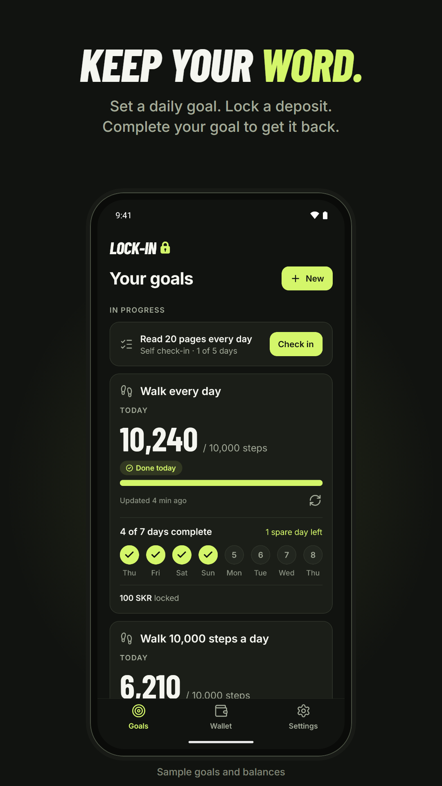
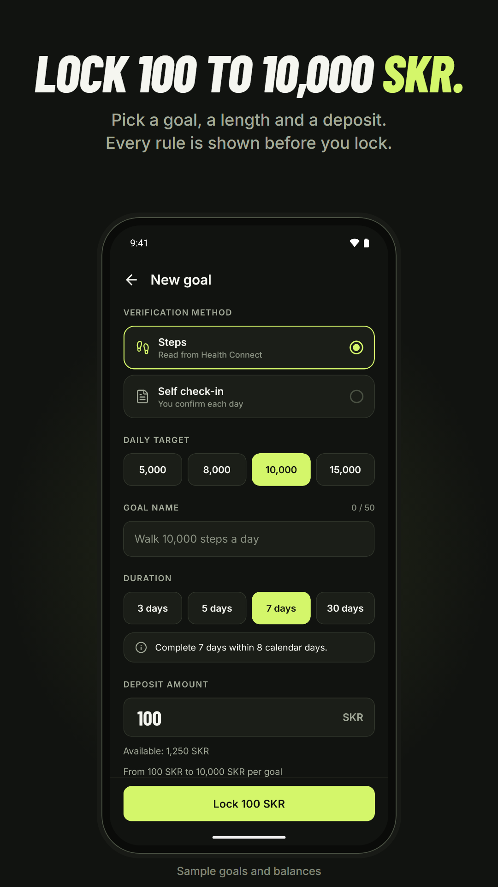
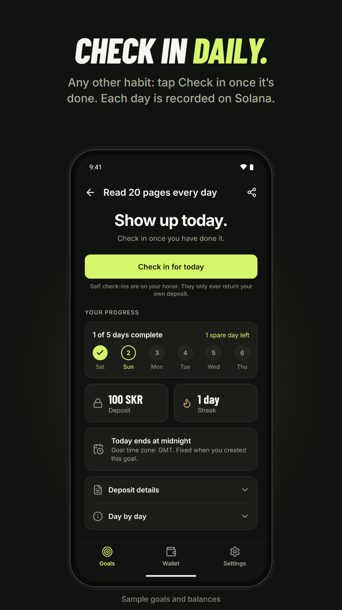
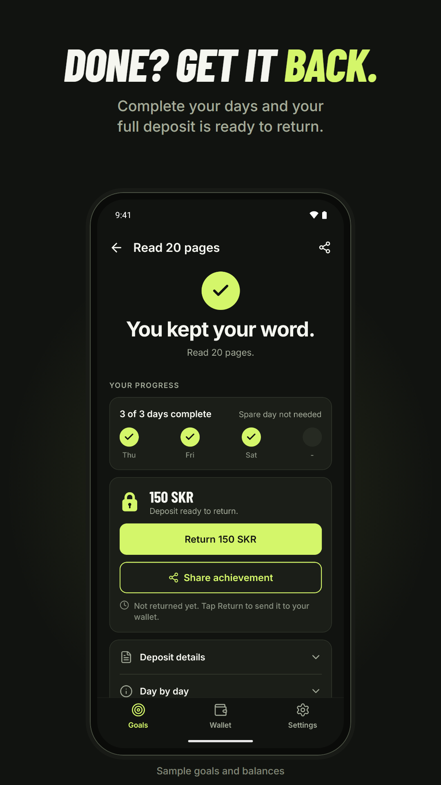

<p align="center"></p>

<h1 align="center">Lock-In</h1>

<p align="center">Commitment staking for Solana Seeker. Put SKR on a habit goal, check in every day, get your deposit back if you keep your word.</p>

<p align="center">
  <a href="https://lockinhq.app">Website</a> ·
  Live in the <a href="solanadappstore://details?id=app.lockin.mobile">Solana dApp Store</a> ·
  <a href="https://solscan.io/account/6za6iZpEP96dN76pGYj27JmqzMgkRQ3JT3SnvrsZbHbv">Program on Solscan</a>
</p>

<p align="center">
  
  
  
  
</p>

## How it works

1. **Create a goal.** For example "10,000 steps, 5 of 7 days" or a self-check goal. Lock 100-10,000 SKR in an on-chain vault.
2. **Check in.** Step goals read Health Connect on the phone; the daily step count never leaves the device. Only a yes/no per day goes on-chain.
3. **Settle.** Hit the target and the deposit goes back to you, any time. Miss it and after the goal closes the deposit is forfeited.

There is no backend. The program holds the money and enforces the rules; the app is a client for it.

## Repository

| Folder | What's inside |
|---|---|
| [`program/`](program) | Anchor program (Rust): pledges, per-goal token vaults, check-ins, settlement, admin and safe mode. 22 LiteSVM tests. |
| [`seeker-app/`](seeker-app) | Android app (Expo / React Native) with Mobile Wallet Adapter, Health Connect, local reminders. |
| [`website/`](website) | Static landing page, rules, privacy policy and terms. Plain HTML and CSS. |

## Design notes

- **Money never sits with the developer.** Each pledge has its own vault PDA. The admin can't change an existing pledge, its recipient or its rules; every pledge stores a snapshot of the config it was created with.
- **Time-zone safe calendar.** The app computes the UTC boundaries of every day (DST-aware) when the goal is created. The program validates them once (strictly increasing, 22-26 h per day, starts within 48 h) and only uses timestamps after that.
- **Device key for check-ins.** A per-goal key lives in the phone's Android Keystore and signs daily check-ins, so the user doesn't have to open the wallet every day. The owner can rotate it after a reinstall.
- **Permissionless settlement.** Anyone can call `settle`. If the app disappears, users can still get their money out.
- **Safe mode.** In an emergency the admin can stop forfeits and let owners withdraw. It can only ever send money back to the owner.
- **Every wallet transaction is simulated** before the wallet opens, so users never sign something that will fail.

## Program

| | |
|---|---|
| Program ID (mainnet) | `6za6iZpEP96dN76pGYj27JmqzMgkRQ3JT3SnvrsZbHbv` |
| Token | SKR `SKRbvo6Gf7GondiT3BbTfuRDPqLWei4j2Qy2NPGZhW3` |
| Stack | Anchor 1.2, Agave 4.3, SBPF v3, LiteSVM |

Instructions: `init_config`, `update_config`, `transfer_admin` / `accept_admin`, `set_paused_new`, `set_safe_mode`, `create_pledge`, `check_in`, `set_device_key`, `settle`, `refund_in_safe_mode`, `close_pledge`. Details in [`program/README.md`](program/README.md).

## App

Expo 55, React Native 0.83, React 19, `@solana/web3.js`, `@solana-mobile/mobile-wallet-adapter`, TanStack Query. The on-chain client in [`seeker-app/lib/chain/`](seeker-app/lib/chain) encodes instructions by hand from the IDL, no Anchor client in the bundle.

```bash
cd seeker-app
npm install
npx expo run:android        # dev build on a device or emulator
npx tsx scripts/lockin-e2e.ts   # end-to-end check against a validator
```

Release builds: [`seeker-app/BUILD_LOCAL.md`](seeker-app/BUILD_LOCAL.md).

## License

MIT
